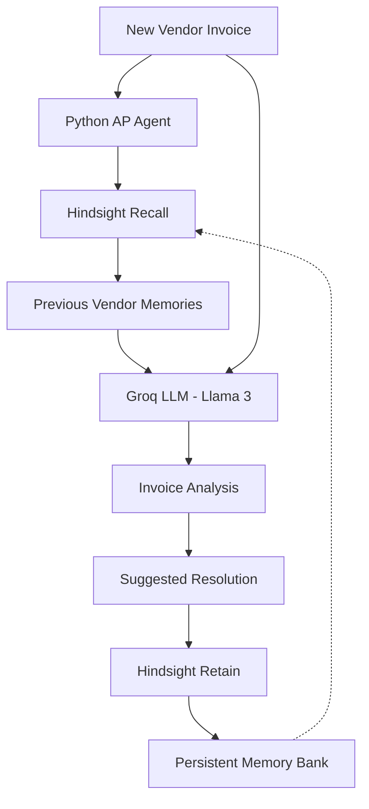

# AP Memory Agent
### An Accounts Payable AI Agent That Remembers Previous Vendor Interactions

An AI-powered Accounts Payable assistant that uses persistent memory to recall previous vendor invoice discrepancies, analyse new invoices with historical context, and retain useful information for future interactions.

**Built with Python, Hindsight, Groq, and Llama 3.**

---

## Overview

Traditional AI agents often process requests independently, without automatically remembering the context of previous interactions.

In Accounts Payable (AP), this creates a practical problem. When the same vendor repeatedly submits invoices with similar discrepancies, an agent without persistent memory must analyse each situation without automatically knowing how previous issues were handled.

**AP Memory Agent addresses this problem through persistent agent memory.**

By integrating Hindsight, the agent can retain previous vendor interactions and retrieve relevant information when processing subsequent invoices.

The goal is to make invoice analysis more context-aware by connecting past interactions with current decisions.

## The Problem

Accounts Payable departments handle invoices from multiple vendors, often encountering recurring issues such as:

- Repeated invoice discrepancies.
- Inconsistent freight charges.
- Vendor-specific billing patterns.
- Repeated manual investigation.
- Lack of continuity between invoice-processing interactions.

A conventional stateless AI workflow does not automatically preserve this historical context.

This means useful information from a previous interaction may not be available when the next invoice arrives.

## Our Solution

AP Memory Agent introduces persistent memory into the invoice-analysis workflow.

Instead of treating every invoice as an isolated request, the agent uses Hindsight to retrieve relevant vendor history before analysing a new invoice.

It follows three core operations:

**Recall → Reason → Retain**

1. **Recall:** Retrieve relevant previous vendor interactions from Hindsight.
2. **Reason:** Use Groq and Llama 3 to analyse the current invoice alongside the retrieved historical context.
3. **Retain:** Store the current interaction so it can potentially inform future invoice analysis.

This creates continuity between interactions without requiring the language model to maintain the entire history itself.

## Key Features

- Persistent memory using Hindsight.
- Vendor-related historical context retrieval.
- AI-assisted invoice discrepancy analysis.
- Context-aware reasoning using Groq and Llama 3.
- Retention of previous invoice interactions.
- Support for a first-time vendor scenario with no previous memory.
- A Recall, Reason, and Retain workflow.

## System Architecture

The system separates memory management from language-model reasoning.



### Architecture Explanation

| Component | Responsibility |
|---|---|
| Python | Coordinates the agent workflow |
| Hindsight | Stores and retrieves persistent memories |
| Groq | Provides LLM inference |
| Llama 3 | Analyses invoice information and historical context |

## How It Works

### 1. Invoice Input

The agent receives vendor information and invoice details.

### 2. Memory Retrieval

Before analysing the invoice, the agent queries Hindsight for relevant previous interactions associated with the vendor.

### 3. Contextual Reasoning

The retrieved information is combined with the current invoice details and passed to the LLM through Groq.

### 4. Analysis

The language model analyses the available information and generates a response with potential discrepancies and suggested resolutions.

### 5. Memory Retention

The agent retains the current interaction in Hindsight for possible retrieval during future requests.

## Hindsight Integration

Hindsight is the core memory layer of AP Memory Agent.

Rather than relying only on temporary conversation context, the implementation uses persistent memory operations.

The integration revolves around two important operations:

**Recall**

Retrieves relevant historical information.

```python
memory_results = hindsight.recall(
    bank_id=BANK_ID,
    query=f"{vendor_name} invoice discrepancies"
)
```

**Retain**

Stores information from the current interaction.

```python
hindsight.retain(
    bank_id=BANK_ID,
    content=new_memory
)
```

Together, these operations allow the agent to access information retained from previous interactions.

Learn more about Hindsight:

- [Hindsight GitHub Repository](https://github.com/vectorize-io/hindsight)
- [Hindsight Documentation](https://hindsight.vectorize.io/)

## Demonstration

The project demonstrates persistent memory through two consecutive invoice interactions involving the same vendor.

**First Interaction**

- Vendor: Acme Corp
- Invoice: #1001
- Memory: No previous vendor history available.
- The agent analyses the invoice and retains the interaction.

**Second Interaction**

- Vendor: Acme Corp
- Invoice: #1002
- Memory: The agent searches for previously retained vendor information.
- The retrieved context is made available during the new analysis.

The demonstration illustrates how persistent memory can provide historical context across separate interactions.

## Technology Stack

| Technology | Purpose |
|---|---|
| Python | Core implementation |
| Hindsight | Persistent agent memory |
| Groq | LLM inference |
| Llama 3 | Language-model reasoning |

## Getting Started

### Prerequisites

- Python 3.10 or later.
- A Groq API key.
- Hindsight API access and credentials.
- Git installed on your system.

### 1. Clone the Repository

```bash
git clone https://github.com/vijaykumaryathnur-dotcom/AP-Memory-Agent.git
```

### 2. Navigate to the Project

```bash
cd AP-Memory-Agent
```

### 3. Create a Virtual Environment

```bash
python -m venv venv
```

Activate it:

**Windows**

```bash
venv\Scripts\activate
```

**Linux / macOS**

```bash
source venv/bin/activate
```

### 4. Install Dependencies

Install the Python packages required by the project:

```bash
pip install groq hindsight-client
```

If the repository includes a `requirements.txt`, use:

```bash
pip install -r requirements.txt
```

### 5. Configure API Credentials

Obtain the required credentials from:

- [Groq Console](https://console.groq.com/)
- [Hindsight](https://hindsight.vectorize.io/)

Configure your credentials securely using environment variables. Never commit API keys or secrets to GitHub.

The application should be configured to read:

```env
GROQ_API_KEY=your_groq_api_key
HINDSIGHT_API_KEY=your_hindsight_api_key
```

Also configure the Hindsight service endpoint and memory bank according to your implementation.

### 6. Run the Agent

```bash
python agent.py
```

Follow the execution output to observe the invoice-analysis and memory workflow.

## Project Structure

```text
AP-Memory-Agent/
│
├── agent.py
├── README.md
├── requirements.txt
└── .gitignore
```

*Note: This is the intended minimal structure. Update it to match the actual files in the repository.*

## Current Scope and Limitations

The current implementation focuses on demonstrating persistent memory in an Accounts Payable workflow.

It should not be considered a complete enterprise accounting or invoice-processing platform.

The current scope does not establish production-grade OCR, accounting-system integration, automated payment processing, or autonomous approval workflows.

## Future Scope

Potential improvements include:

- Automated invoice data extraction.
- Advanced vendor profiling.
- Duplicate invoice detection.
- More sophisticated discrepancy classification.
- Vendor-specific memory retrieval.
- Human-in-the-loop approval workflows.
- Accounting and ERP integrations.
- Improved auditability and validation.

## Why Hindsight?

An agent's ability to reason is important, but the ability to access useful information from previous interactions can make its behaviour more context-aware.

Hindsight provides the persistent memory layer that makes this possible in AP Memory Agent.

By separating memory retrieval and retention from LLM reasoning, the implementation demonstrates a practical approach to building agents that maintain continuity across interactions.

## Project Repository

[AP Memory Agent – GitHub](https://github.com/vijaykumaryathnur-dotcom/AP-Memory-Agent)

## Acknowledgements

- [Vectorize – Hindsight](https://vectorize.io/)
- [Groq](https://groq.com/)


---

**AP Memory Agent**

*Recall. Reason. Retain.*
